<div align="center">

# ◉ OPENJARVIS HUD

**A sci-fi holographic command console for your own private, local AI.**

The interface is hosted on Vercel. The AI runs on your computer. Your conversations never leave it.

[**▶ Live demo: openjarvis-hud.vercel.app**](https://openjarvis-hud.vercel.app)


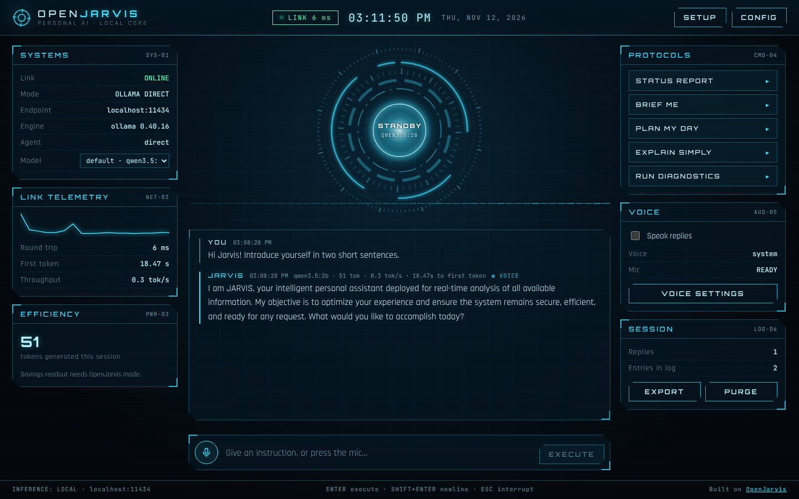

</div>

---

## Table of contents

1. [What is this?](#-what-is-this)
2. [Features](#-features)
3. [Screenshots](#-screenshots)
4. [How it works](#-how-it-works)
5. [Quick start for users (Windows)](#-quick-start-for-users-windows)
6. [Quick start for users (macOS / Linux)](#-quick-start-for-users-macos--linux)
7. [Jarvis Companion: web research + scheduled tasks](#️-jarvis-companion-web-research--scheduled-tasks)
8. [Connection modes: Ollama direct vs OpenJarvis](#-connection-modes)
8. [Using the HUD](#-using-the-hud)
9. [Troubleshooting](#-troubleshooting)
10. [Privacy & security](#-privacy--security)
11. [For developers](#-for-developers)
12. [Project structure](#-project-structure)
13. [Architecture deep-dive](#-architecture-deep-dive)
14. [Design system](#-design-system)
15. [Deployment](#-deployment)
16. [Roadmap](#-roadmap)
17. [FAQ](#-faq)
18. [License](#-license)
19. [Credits & disclaimer](#-credits--disclaimer)

---

## 🧠 What is this?

**OpenJarvis HUD** is a holographic, film-inspired interface for chatting with an AI assistant that runs **on your own hardware**.

Most AI assistants send everything you type to a company's servers. This one doesn't. The web page is just the "screen", and the "brain" is a local model running on your PC through [**Ollama**](https://ollama.com), or through the [**OpenJarvis**](https://github.com/open-jarvis/OpenJarvis) agent framework from Stanford's Hazy Research and Scaling Intelligence Lab.

- **Private by design:** prompts and replies go from your browser straight to `localhost`.
- **Free to run:** no API keys and no per-message costs; your own computer does the work.
- **Looks the part:** an animated core, telemetry panels, voice input and spoken replies.

---

## ✨ Features

| | Feature | Details |
|---|---|---|
| 🌀 | **Reactive holographic core** | Six rotating instrument rings whose speed and colour follow Jarvis's state: **Standby**, **Listening**, **Processing**, **Responding**, **Offline** |
| 🗂️ | **Projects** | Group chats, custom instructions and reference files into projects such as "Startup pitch" or "College notes"; Jarvis reads them automatically |
| 🧠 | **Memory** | Say *"remember that I prefer short answers"*; saved facts are added to every reply, and you can view or delete them any time |
| 💬 | **Multiple chats** | Unlimited chats per project, saved in your browser's IndexedDB |
| 📄 | **Document analysis** | Attach or drag in **PDF, Word (.docx), Excel (.xlsx), CSV, text and code** files; text is extracted in your browser and summarised, queried or compared |
| 🖼️ | **Image & chart analysis** | Attach or paste screenshots, photos and charts; the local vision model (`qwen3.5:2b` supports images) describes and reads them |
| ✍️ | **Writing mode** | Emails, articles, stories, reports, posts, letters and speeches in 9 tones and 3 lengths |
| 🌍 | **Translation mode** | 21 languages including Telugu, Hindi, Tamil, Kannada, Malayalam, Marathi, Bengali, Spanish, French, German, Arabic, Chinese and Japanese |
| 📁 | **Office file creation** | Ask for a **Word, PowerPoint, Excel or PDF** file and download a real formatted file, built in your browser; any answer can also be exported to .docx or .pdf |
| 📊 | **Dashboards** | Turn a spreadsheet, CSV or pasted numbers into KPI cards and live charts; open full screen or download as a standalone HTML file |
| ◳ | **Artifacts** | Diagrams, calculators and mini web apps generated as HTML and run in a sandboxed preview |
| 🌐 | **Web research with citations** | Through **Jarvis Companion** and your own free Tavily or Brave key: numbered sources, inline [1] citations and a source list |
| ⏰ | **Background scheduled tasks** | Through **Jarvis Companion**, e.g. *"every weekday at 8:00, brief me on tech news"*; runs even with the browser closed, and results land in an inbox |
| 🎙️ | **Conversation mode** | Hands-free voice loop: Jarvis listens, answers aloud, then listens again; say "stop" to end |
| 💬 | **Streaming chat** | Replies appear word by word as they're generated, rendered as formatted Markdown (lists, code, tables, links) and sanitised against injected HTML |
| 🎤 | **Voice input** | Click the mic and speak; the transcript fills in live and sends when you stop talking |
| 🔊 | **Spoken replies** | Jarvis reads answers aloud using your system's voices, preferring a British English voice; you can choose any voice |
| 🛠️ | **Live agent activity** | In OpenJarvis mode, tool calls such as `web_search` appear step by step as the agent works |
| 🧩 | **Reasoning trace** | When a model emits `<think>` reasoning, it's tucked into an expandable "Reasoning trace" instead of cluttering the answer |
| 📡 | **Link telemetry** | Live connection latency with a sparkline, time to first token and tokens per second |
| 💰 | **Efficiency panel** | In OpenJarvis mode: dollars saved compared with cloud models, tokens processed on-device and cloud energy avoided |
| ⚡ | **Protocols** | One-click commands: Status Report, Brief Me, Plan My Day, Explain Simply, Run Diagnostics |
| 🎭 | **Persona editor** | Change Jarvis's personality with your own system prompt |
| 🔀 | **Model switcher** | Pick any model installed on your machine |
| 🧾 | **Session log** | Conversation saved in your browser; export to Markdown, or purge with one click |
| 🧭 | **Guided setup** | A built-in SETUP panel with copy-paste commands for Windows, macOS and Linux, pre-filled with the site's own address |
| 🚀 | **Boot sequence** | A short cinematic start-up; click or press any key to skip |
| 📱 | **Responsive** | Works on desktop, tablet and phone |
| ♿ | **Accessible** | Keyboard shortcuts, ARIA labels, live regions and `prefers-reduced-motion` support |

---

## 📸 Screenshots

| Standby | Conversation |
|---|---|
| 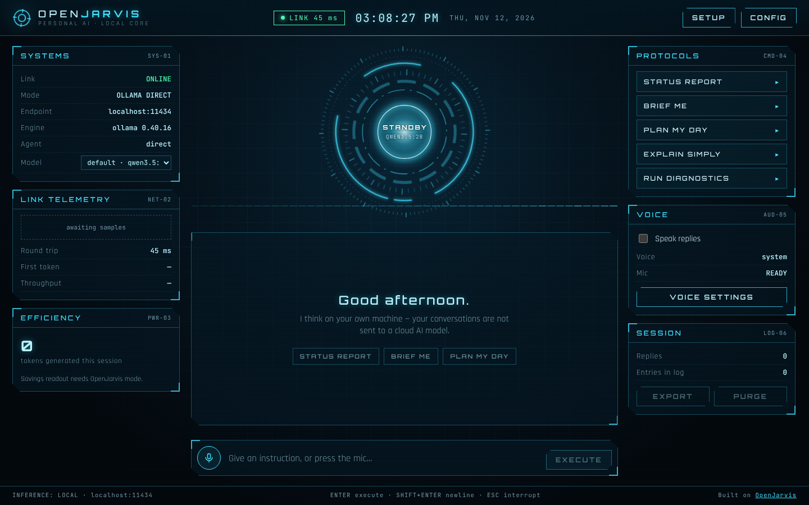 |  |

| Guided setup | Link configuration |
|---|---|
| 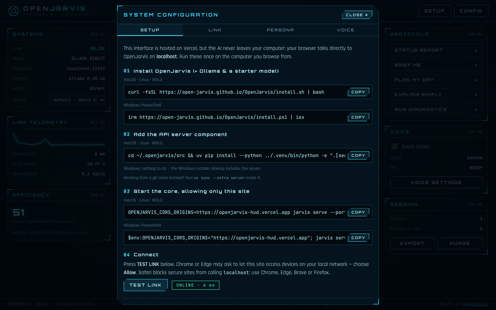 | 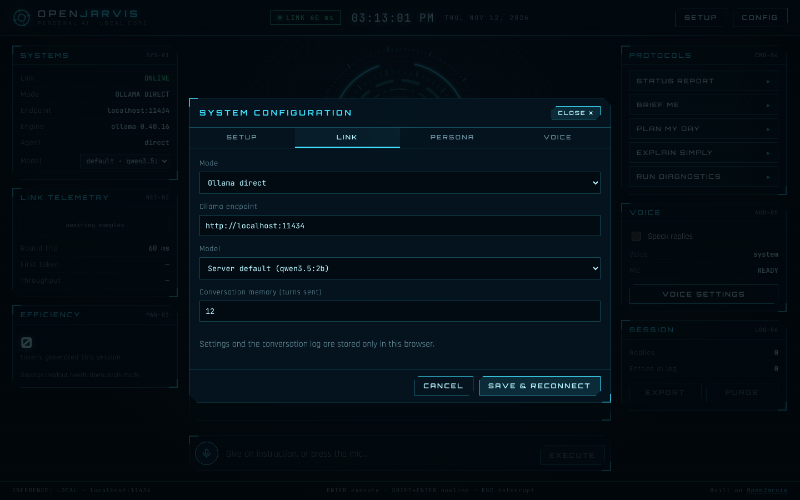 |

| Dashboard from a CSV | Artifact (live mini app) | Web research with citations |
|---|---|---|
| 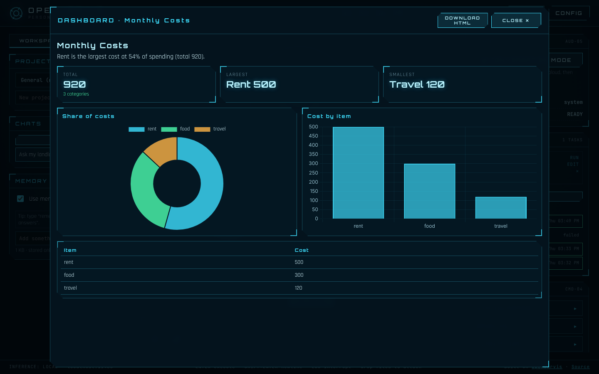 | 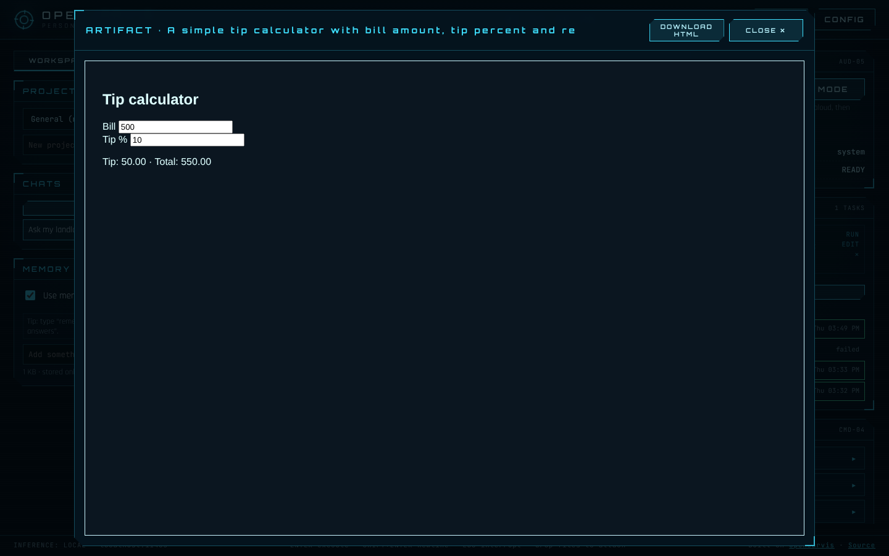 | 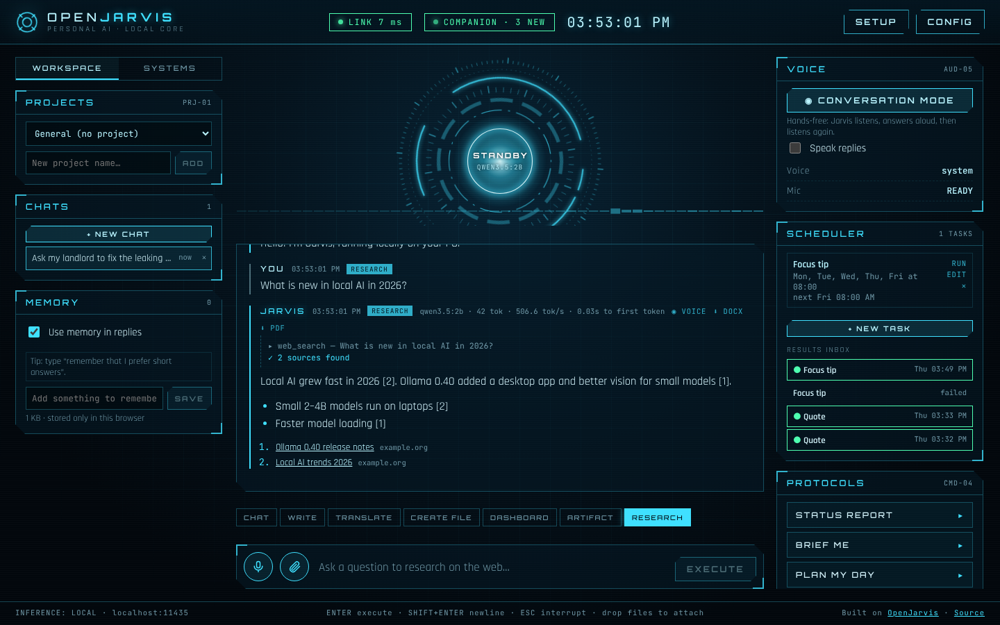 |

<sub>The feature screenshots above use example data.</sub>

| Boot sequence | Offline state | Mobile |
|---|---|---|
| 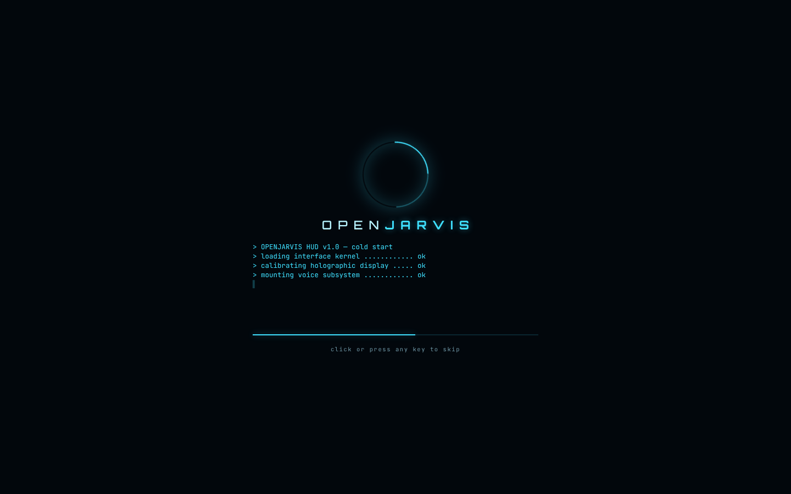 | 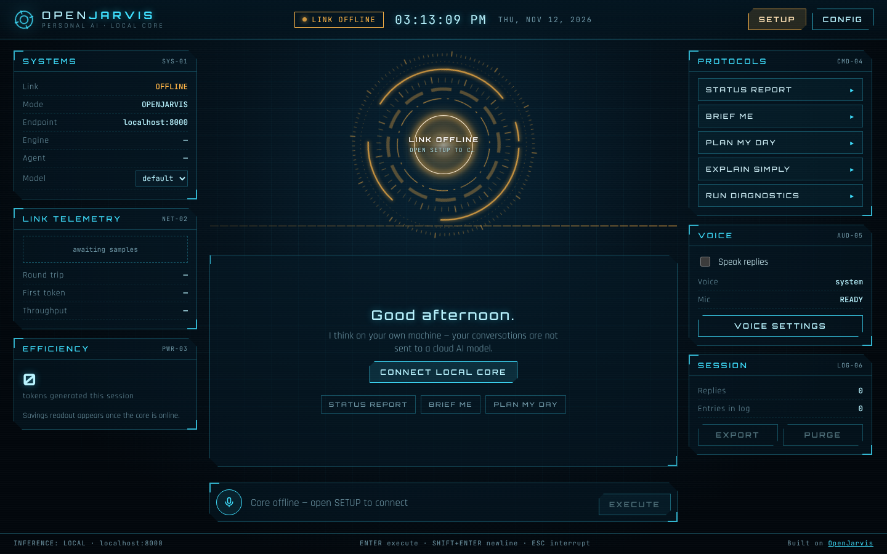 | 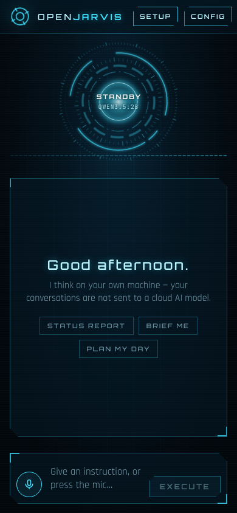 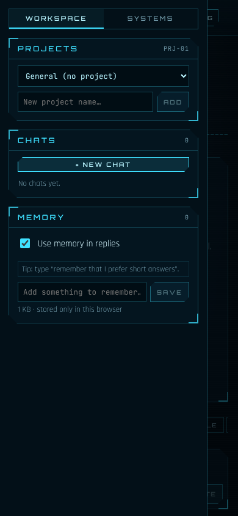 |

---

## 🔌 How it works

```
 ┌──────────────────────────────┐        ┌─────────────────────────────────────┐
 │  Your browser                │        │  Your computer (localhost)          │
 │                              │  HTTP  │                                     │
 │  openjarvis-hud.vercel.app ──┼───────▶│  Ollama           :11434  ← simple  │
 │  (static React app)          │ stream │      or                             │
 │                              │◀───────┼  OpenJarvis API   :8000   ← agents  │
 └──────────────────────────────┘        │      └─▶ Ollama + local model       │
               ▲                         └─────────────────────────────────────┘
               │ only HTML/CSS/JS
        ┌──────┴───────┐
        │    Vercel    │   never sees your prompts or replies
        └──────────────┘
```

1. Vercel serves the static web app: HTML, CSS and JavaScript.
2. The app runs entirely in your browser.
3. Your browser calls your **own machine** at `http://localhost`. Browsers treat `localhost` as a secure context, so a secure (https) page is allowed to call it.
4. Your local AI server must explicitly allow the website's address through **CORS**. That's why the setup step tells Ollama or OpenJarvis which site is allowed.

> **Consequence:** every visitor needs their own local AI running. Sharing the link shares the *interface*, not your computer.

---

## 🪟 Quick start for users (Windows)

The **light setup (Ollama direct)** needs about **5 GB** free disk space and takes about 15 minutes, mostly downloading.

**1. Install Ollama.** Open **PowerShell** from the Start menu and run:
```powershell
winget install Ollama.Ollama
```

**2. Close PowerShell, open a new one, and download a model** (about 2.7 GB):
```powershell
ollama pull qwen3.5:2b
```

**3. Allow the website to talk to Ollama:**
```powershell
setx OLLAMA_ORIGINS "https://openjarvis-hud.vercel.app"
```

**4. Restart Ollama so it picks up the setting.** Run this in the same window:
```powershell
$env:OLLAMA_ORIGINS="https://openjarvis-hud.vercel.app"; Stop-Process -Name "ollama*" -Force -ErrorAction SilentlyContinue; Start-Sleep 2; Start-Process "$env:LOCALAPPDATA\Programs\Ollama\ollama app.exe"
```

**5. Check it.** You should see `HTTP/1.1 200 OK` and an `Access-Control-Allow-Origin` line:
```powershell
curl.exe -s -i -H "Origin: https://openjarvis-hud.vercel.app" http://localhost:11434/api/version
```

**6. Connect.** Open the site in **Chrome or Edge**, then go to **CONFIG → Mode → Ollama direct → SAVE & RECONNECT**. When the light turns green, say hello. 🎉

After this, Ollama starts with Windows, so you only need to open the website.

<details>
<summary><b>Full setup on Windows (OpenJarvis agents, web search, savings panel)</b></summary>

Needs about **20 GB** free. It also needs Microsoft C++ Build Tools to compile OpenJarvis's native extension.

```powershell
winget install --id Microsoft.VisualStudio.2022.BuildTools --override "--wait --quiet --add Microsoft.VisualStudio.Workload.VCTools --includeRecommended"
```
Close PowerShell, open a new one, and then:
```powershell
irm https://open-jarvis.github.io/OpenJarvis/install.ps1 | iex
```
Close PowerShell, open a new one, and start the core (keep this window open):
```powershell
$env:OPENJARVIS_CORS_ORIGINS="https://openjarvis-hud.vercel.app"; jarvis serve --port 8000
```
In the HUD, set **CONFIG → Mode → OpenJarvis server**. On Windows, OpenJarvis installs to `%LOCALAPPDATA%\OpenJarvis` and already includes the API server.
</details>

---

## 🍎 Quick start for users (macOS / Linux)

**Light (Ollama direct)**
```bash
# 1. Install Ollama from https://ollama.com/download (macOS app) or:
curl -fsSL https://ollama.com/install.sh | sh

# 2. Download a model
ollama pull qwen3.5:2b

# 3. Start Ollama allowing the HUD (quit the Ollama menu-bar app first on macOS)
OLLAMA_ORIGINS=https://openjarvis-hud.vercel.app ollama serve
```

**Full (OpenJarvis)**
```bash
curl -fsSL https://open-jarvis.github.io/OpenJarvis/install.sh | bash
cd ~/.openjarvis/src && uv pip install --python ../.venv/bin/python -e ".[server]"
OPENJARVIS_CORS_ORIGINS=https://openjarvis-hud.vercel.app jarvis serve --port 8000
```

> **Safari** blocks secure pages from calling `http://localhost`. Use Chrome, Edge, Brave or Firefox.

---

## 🛰️ Jarvis Companion (web research + scheduled tasks)

Two features can't work inside a browser tab alone:

- **Searching the web.** Search APIs block direct browser calls, and your API key must stay private.
- **Running tasks when the browser is closed.**

**Jarvis Companion** is a ~20 KB Python program (standard library only, no `pip install`) that runs quietly on your PC at `http://127.0.0.1:8765`.

### Install (Windows, no admin)
```powershell
irm https://openjarvis-hud.vercel.app/companion/install.ps1 | iex
```
The installer:
1. Finds Python, or installs Python 3.13 with winget.
2. Saves the program to `%LOCALAPPDATA%\JarvisCompanion`.
3. Adds a **Startup** shortcut, so it starts every time you sign in.
4. Starts it, and checks that it answers.

macOS / Linux:
```bash
curl -fsSL https://openjarvis-hud.vercel.app/companion/jarvis_companion.py -o ~/jarvis_companion.py && python3 ~/jarvis_companion.py
```

### Add your free search key
1. Create a free key at [Tavily](https://app.tavily.com) (recommended, built for AI) or the [Brave Search API](https://api-dashboard.search.brave.com).
2. In the HUD, go to **SETUP → COMPANION**, paste the key, and click **SAVE KEY & TEST**.

The key is stored only in `%LOCALAPPDATA%\JarvisCompanion\config.json` on your PC.

### What it does
| Endpoint | Purpose |
|---|---|
| `GET /health` | Status, version, whether a search key is saved |
| `POST /config` | Save search provider/key, model, persona and memory (used by scheduled tasks) |
| `POST /search` | Web search through Tavily or Brave; returns titles, URLs and text snippets |
| `GET/POST /tasks`, `DELETE /tasks/{id}` | Create, edit and delete scheduled tasks (daily, chosen weekdays, hourly, every N minutes) |
| `POST /tasks/{id}/run` | Run a task now |
| `GET /runs`, `POST /runs/{id}/read` | Results inbox |

Scheduled tasks call your local Ollama model, optionally after a web search. Results are stored in a local SQLite database, `jarvis.db`. If the PC was off at the scheduled time, the task runs once when the Companion next starts.

**Security:**
- It listens on `127.0.0.1` only.
- It answers only the HUD's own web address (CORS) and requests carrying an `X-Jarvis` header, so other websites can't use it.
- Logs are kept in `companion.log`.

**Uninstall:** press Win + R, type `shell:startup`, and delete **Jarvis Companion**. Then delete `%LOCALAPPDATA%\JarvisCompanion`.

---

## 🔀 Connection modes

| | **Ollama direct** | **OpenJarvis server** |
|---|---|---|
| Endpoint | `http://localhost:11434` | `http://localhost:8000` |
| Disk space | ~5 GB | ~20 GB (Windows, including build tools) |
| Setup effort | Easy | Moderate |
| Chat, voice, core, telemetry | ✅ | ✅ |
| Agents and tool use (web search, …) | ❌ | ✅ |
| Live tool activity in the log | ❌ | ✅ |
| Efficiency / savings panel | ❌ | ✅ |
| Allowed-site setting | `OLLAMA_ORIGINS` | `OPENJARVIS_CORS_ORIGINS` |
| API used | `/api/chat` (NDJSON stream) | `/v1/chat/completions` (OpenAI-compatible SSE) |

Switch modes any time in **CONFIG → Link**.

---

## 🎮 Using the HUD

### Layout
- **Top bar:** link status (green = online, with latency), clock, **SETUP** (pulses amber when offline) and **CONFIG**.
- **Left column:** **SYSTEMS** (mode, endpoint, engine, agent, model picker), **LINK TELEMETRY** and **EFFICIENCY**.
- **Centre:** the **core**, a waveform, the conversation log and the command bar.
- **Right column:** **PROTOCOLS**, **VOICE** and **SESSION** (export / purge).

### Core states
| State | Colour | Meaning |
|---|---|---|
| STANDBY | Cyan, slow spin | Connected and idle |
| LISTENING | Green | Microphone is live |
| PROCESSING | Blue, fast spin | Waiting for the first words; shows tool activity such as `TOOL · WEB_SEARCH` |
| RESPONDING | Cyan, fast | Streaming or speaking a reply |
| LINK OFFLINE / HANDSHAKE | Amber, flicker | Can't reach your local AI |

### Modes (the chips above the message box)
| Mode | What to type | What you get |
|---|---|---|
| CHAT | Anything | A normal conversation; attach files or images to ask about them |
| WRITE | "A polite email asking for Friday off" | A finished piece in the chosen type, tone and length |
| TRANSLATE | Paste text | The translation, plus notes on tricky words |
| CREATE FILE | "A 6-slide deck about…" (+ optional attachments) | A downloadable .docx, .pptx, .xlsx or .pdf |
| DASHBOARD | Attach a CSV or Excel file, or paste numbers | KPI cards and charts, full screen, downloadable as HTML |
| ARTIFACT | "A tip calculator", "a flowchart of…" | A live mini app or diagram in a sandbox |
| RESEARCH | A question about current events | A cited answer from web sources (needs the Companion and a search key) |

### Workspace (left column)
- **Projects:** choose or create one. Add instructions and reference files; every chat in the project uses them.
- **Chats:** start a new chat, switch between chats, or delete one.
- **Memory:** add or remove facts. Turn "Use memory in replies" off to pause it.

### Files
Click the **paperclip**, drag files onto the conversation, or paste an image. Supported: PDF, DOCX, XLSX/XLSM, CSV/TSV, TXT/MD/JSON/HTML/code, and images. Large files are trimmed to fit **CONFIG → Max context**; raise it for long documents if your PC has enough RAM.

### Keyboard shortcuts
| Key | Action |
|---|---|
| `Enter` | Send |
| `Shift + Enter` | New line |
| `Esc` | Interrupt the reply and stop speaking |
| Any key (during boot) | Skip the boot sequence |

### Protocols
| Button | What it asks |
|---|---|
| STATUS REPORT | Who Jarvis is, plus three things it can help with now |
| BRIEF ME | A three-bullet summary of the conversation and a next step |
| PLAN MY DAY | Up to three questions, then a schedule |
| EXPLAIN SIMPLY | Re-explains the last answer with an everyday analogy |
| RUN DIAGNOSTICS | A local link test: latency, engine, agent and model list |

### Settings (CONFIG)
- **Link:** mode, endpoints, optional API key (OpenJarvis), model, and how many past turns to send as memory.
- **Persona:** the system prompt that defines Jarvis's personality.
- **Voice:** spoken replies on or off, and voice selection.
- **Setup:** install and start commands with copy buttons, plus a **TEST LINK** button.

---

## 🩺 Troubleshooting

| Symptom | Cause | Fix |
|---|---|---|
| `LINK OFFLINE`, "Cannot reach http://localhost:…" | Local server not running | Windows: open **Ollama** from the Start menu. OpenJarvis: run `jarvis serve`. |
| `curl` with `Origin:` returns **403 Forbidden** | The allowed-site setting isn't applied | Re-run step 4 of the Windows quick start. `setx` only affects **new** processes. |
| Offline in the browser, but `curl` works | The browser is blocking local network access | Click the icon left of the URL → **Site settings** → **Local network access: Allow**. In Brave, turn Shields off for the site. |
| Works in Chrome, not in Safari | Safari blocks https → http://localhost | Use Chrome, Edge, Brave or Firefox |
| First reply is very slow | The model is loading into RAM | Normal on the first message; later replies are faster |
| Every reply is slow | Big model on a modest CPU | Use a smaller model, e.g. `ollama pull qwen3:0.6b`, and pick it in the model list |
| `ollama pull` fails with "no such host" | DNS can't resolve the download server | Set DNS to `8.8.8.8` / `1.1.1.1` (Settings → Network → DNS), run `ipconfig /flushdns`, and retry; downloads resume |
| winget exit code `2147942512` | Disk full (`0x80070070`) | Free space on C: and retry |
| `MSVC build tools not found` (OpenJarvis install) | Missing C++ linker | Install the Build Tools (see the full Windows setup), then re-run the installer |
| `jarvis is not recognized` | PATH not refreshed | Close PowerShell and open a new one |
| Mic says "not supported" | The browser lacks the Web Speech API | Use Chrome or Edge |
| COMPANION pill is grey | The Companion isn't running | Run the installer again, or start it from the Startup shortcut; check `%LOCALAPPDATA%\\JarvisCompanion\\companion.log` |
| Research says "Add your search API key" | No key saved | **SETUP → COMPANION**: paste your Tavily or Brave key |
| File or dashboard says "incomplete result" | The small model ran out of room or lost track | Try again with a shorter request, or raise **Max context** |
| A PDF shows no text | It's a scanned image | Take a screenshot of the page and attach it as an image instead |
| Non-English text looks broken in exported PDFs | PDF export uses standard fonts | Export to **Word (.docx)** for Telugu, Hindi and other scripts |

Quick health checks:
```powershell
curl.exe http://localhost:11434/api/version     # Ollama
curl.exe http://localhost:8000/health           # OpenJarvis
ollama ps                                        # loaded models, and CPU vs GPU
```

---

## 🔒 Privacy & security

- **Your prompts and replies never touch Vercel.** The page calls `localhost` directly from your browser.
- **Settings and chat history** live in your browser's `localStorage`. Clear them with **PURGE** or your browser settings.
- **Voice input:** Chrome and Edge send microphone audio to their speech service (Google or Microsoft) for transcription. Typed messages stay local.
- **Spoken replies** use voices installed on your device.
- **Web search (OpenJarvis mode):** when the agent searches, the search query goes to a web search provider. The AI model itself stays local.
- **Chats, projects, attached files and memory** are stored in your browser's IndexedDB on this computer.
- **Jarvis Companion** keeps your search key, tasks and results in `%LOCALAPPDATA%\\JarvisCompanion`. Only your search words are sent to the search provider.
- **Artifacts** run in a sandboxed iframe without access to the HUD, your storage or your files.
- **CORS is your gatekeeper.** Only allow the exact HUD address, never `*`, so other websites can't use your local AI.
- **Don't expose Ollama to the internet.** It has no authentication, so keep it bound to `localhost`.
- Markdown output is sanitised with **DOMPurify** before rendering.
- `vercel.json` sets `X-Content-Type-Options`, `Referrer-Policy` and a `Permissions-Policy` that allows the microphone only for this site.

---

## 👩‍💻 For developers

### Requirements
- Node.js **20+** (developed with 22)
- A local Ollama or OpenJarvis to talk to

### Run locally
```bash
git clone https://github.com/nagadattasaikondoju-ship-it/jarvis-hud.git
cd jarvis-hud
npm install
npm run dev            # http://localhost:5173
```
OpenJarvis allows `http://localhost:5173` by default. For Ollama:
```bash
OLLAMA_ORIGINS=http://localhost:5173 ollama serve
```

### Scripts
| Command | Description |
|---|---|
| `npm run dev` | Vite dev server with hot reload |
| `npm run build` | Production build into `dist/` |
| `npm run preview` | Serve the production build locally |

### Tech stack
| Layer | Choice | Why |
|---|---|---|
| UI | React 18 | Component model; streaming state updates |
| Build | Vite 6 | Fast dev server; small static output (~80 KB gzipped JS) |
| Markdown | `marked` + `DOMPurify` | Rich replies, safely rendered |
| File reading | `pdfjs-dist`, `mammoth`, `exceljs` | Extract PDF, Word and Excel text in the browser |
| File creation | `docx`, `pptxgenjs`, `exceljs`, `jspdf` | Real Office/PDF files, no server |
| Charts | `chart.js` | Dashboard charts |
| Storage | IndexedDB | Chats, projects, files and memory |
| Companion | Python 3 standard library + SQLite | Search proxy and background scheduler |
| Visuals | Hand-written SVG + CSS animations + `<canvas>` waveform | No heavy graphics libraries; smooth on low-end devices |
| Voice | Web Speech API (`SpeechRecognition`, `speechSynthesis`) | No server needed |
| Fonts | Orbitron, Rajdhani, JetBrains Mono (Google Fonts) | Display, UI and data typography |
| Hosting | Vercel (static) | Free, global CDN, auto-deploy from GitHub |

---

## 🗂️ Project structure

```
jarvis-hud/
├── index.html                 # HTML shell, fonts, meta
├── vite.config.js             # Vite + React plugin
├── vercel.json                # Security headers for Vercel
├── package.json
├── public/
│   └── favicon.svg
├── public/companion/
│   ├── jarvis_companion.py    # The Companion (Python stdlib)
│   └── install.ps1            # One-line Windows installer
├── docs/
│   └── screenshots/           # Images used in this README
└── src/
    ├── main.jsx               # React entry point
    ├── App.jsx                # Layout, state, link monitor, chat flow, voice
    ├── api.js                 # Link layer: probe, streaming chat, savings
    ├── styles.css             # Design tokens, HUD styling, animations, responsive
    ├── store.js           # IndexedDB store: chats, projects, files, memory
    ├── files.js           # In-browser PDF/DOCX/XLSX/CSV/image reading
    ├── modes.js           # Mode prompts + JSON schemas for files/dashboards
    ├── exporters.js       # Builds .docx / .pptx / .xlsx / .pdf in the browser
    ├── companion.js       # Client for Jarvis Companion (search, tasks, inbox)
    └── components/
        ├── Workspace.jsx      # Projects, chats, memory
        ├── Scheduler.jsx      # Background tasks + results inbox
        ├── ArtifactPanel.jsx  # Dashboards (Chart.js) + sandboxed HTML artifacts
        ├── Core.jsx           # Animated SVG core (state-driven)
        ├── Waveform.jsx       # Canvas audio/activity visualiser
        ├── Boot.jsx           # Start-up sequence
        ├── Message.jsx        # Chat message: Markdown, steps, reasoning trace
        └── Settings.jsx       # SETUP / LINK / PERSONA / VOICE modal
```

---

## 🏗️ Architecture deep-dive

### Link layer (`src/api.js`)
- **`probe(cfg)`** checks the connection:
  - OpenJarvis mode calls `GET /health`, then `/v1/info` and `/v1/models`.
  - Ollama mode calls `GET /api/version` and `/api/tags`.
  - It returns `{ ok, latency, engine, agent, defaultModel, models }`.
- **`streamChat(cfg, messages, model, onDelta, signal, onEvent)`** streams a reply:
  - **OpenJarvis:** `POST /v1/chat/completions` with `stream: true`. It parses Server-Sent Events, including **named events** (`tool_call_start`, `tool_call_end`, `inference_start`) that drive the live activity feed.
  - **Ollama:** `POST /api/chat` with `stream: true, think: false`, and parses newline-delimited JSON.
  - It supports cancellation through `AbortController` (the STOP button or Esc).
- **`splitThinking(raw)`** separates `<think>…</think>` reasoning from the visible answer.
- **`savings(cfg)`** reads `GET /v1/savings` (OpenJarvis) for the efficiency panel.

### App state (`src/App.jsx`)
- **Link monitor:** polls every **3 s while offline** (so it connects as soon as the core starts) and every **12 s while online**.
- **Conversation memory:** the last *N* turns, 12 by default, plus the persona are sent with each message.
- **Core state machine:** `offline / connecting → standby ⇄ listening → processing → responding`.
- **Persistence:** settings and the log are stored in `localStorage`. Every access is wrapped in try/catch, so private windows still work.
- **Voice:** `SpeechRecognition` for input, with a Web Audio analyser feeding the waveform. `speechSynthesis` speaks replies, and its word-boundary events animate the core.

### Message rendering (`src/components/Message.jsx`)
Markdown goes through `marked` (GFM) and then `DOMPurify.sanitize`. Agent steps, the reasoning trace, error states and per-reply stats (model, tokens, tok/s, time to first token) are shown inline.

---

## 🎨 Design system

| Token | Value | Use |
|---|---|---|
| `--bg` | `#02070c` | Deep space background |
| `--cyan` | `#3fe0ff` | Primary hologram colour |
| `--ice` | `#b9f4ff` | Primary text and highlights |
| `--ok` | `#4dffb0` | Online and listening |
| `--warn` | `#ffb547` | Offline and warnings |
| `--bad` | `#ff5468` | Errors |
| `--line` | `rgba(63,224,255,.28)` | Panel borders |

- **Typography:** *Orbitron* for headings and labels, *Rajdhani* for UI text, *JetBrains Mono* for data.
- **Panels:** translucent glass with clipped corners and bright corner brackets.
- **Atmosphere:** a masked grid background and a subtle scanline overlay.
- **Motion:** each core ring has its own speed and direction. A shared CSS variable `--k` speeds the rings up or slows them down depending on state. All motion respects `prefers-reduced-motion`.

---

## 🚀 Deployment

The site is a static build, which makes it ideal for Vercel.

**Auto-deploy from GitHub (recommended)**
1. Import this repository in Vercel (**Add New → Project**).
2. Framework preset: **Vite**. Build command: `vite build`. Output directory: `dist`.
3. Every push to `main` deploys to production, and pull requests get preview URLs.

**Manual**
```bash
npm i -g vercel
vercel --prod
```

> If you deploy under a **different domain**, users must allow that domain instead: `OLLAMA_ORIGINS=https://your-domain` or `OPENJARVIS_CORS_ORIGINS=https://your-domain`. The SETUP panel fills in the current site's address automatically.

---

## 🗺️ Roadmap

- [ ] **Cloud mode**, so the link works for everyone without installing anything (server-side API key, login, daily limits)
- [x] Projects, multiple chats and memory (in your browser)
- [x] Document and image analysis, writing modes and translation
- [x] Word / PowerPoint / Excel / PDF creation, dashboards and artifacts
- [x] Web research with citations and background scheduled tasks (Jarvis Companion)
- [x] Hands-free conversation mode
- [ ] User accounts and chat history synced across devices
- [ ] Wake word ("Hey Jarvis")
- [ ] Fully offline speech recognition (Whisper in the browser)
- [ ] One-click desktop app bundling Ollama + HUD
- [ ] Own brand name and custom domain
- [ ] Themes (classic cyan, amber, crimson)

---

## ❓ FAQ

**If I share the link, will Jarvis answer my friends?**
They'll see the interface, but each person needs their own Ollama or OpenJarvis running. The site talks to the visitor's own computer, not yours.

**Does it cost anything?**
No. Vercel hosting is free on the hobby tier, and the AI runs on your hardware.

**Does it work offline?**
The AI does, but the page itself must first load from Vercel. The browser usually caches it.

**Which model should I use?**
`qwen3.5:2b` is a good balance for most laptops. On slower PCs try `qwen3:0.6b`; on strong PCs with a GPU try bigger models.

**Why "Ollama direct" and "OpenJarvis" modes?**
Ollama direct is the light setup. OpenJarvis adds agents, tools, memory and energy and cost telemetry, at the price of a larger install.

---

## 📄 License

Released under the [MIT License](LICENSE) © 2026 Naga Datta. OpenJarvis and Ollama keep their own licences.

---

## 🙏 Credits & disclaimer

- Built on [**OpenJarvis**](https://github.com/open-jarvis/OpenJarvis) (Apache-2.0) from Hazy Research and the Scaling Intelligence Lab at Stanford, and on [**Ollama**](https://ollama.com).
- Models: [Qwen](https://github.com/QwenLM) by Alibaba Cloud.
- Fonts: Orbitron, Rajdhani and JetBrains Mono via Google Fonts.

> **Disclaimer:** this is an independent fan-inspired project. It is **not affiliated with, endorsed by, or connected to Marvel, Disney or the Iron Man films**. "J.A.R.V.I.S." is a Marvel character. This project uses the *OpenJarvis* framework name and an original visual design, with no film assets, logos or characters. If you turn it into a commercial product, choose your own brand name.

<div align="center">

**Made with ◉ by [nagadattasaikondoju-ship-it](https://github.com/nagadattasaikondoju-ship-it)**

</div>
